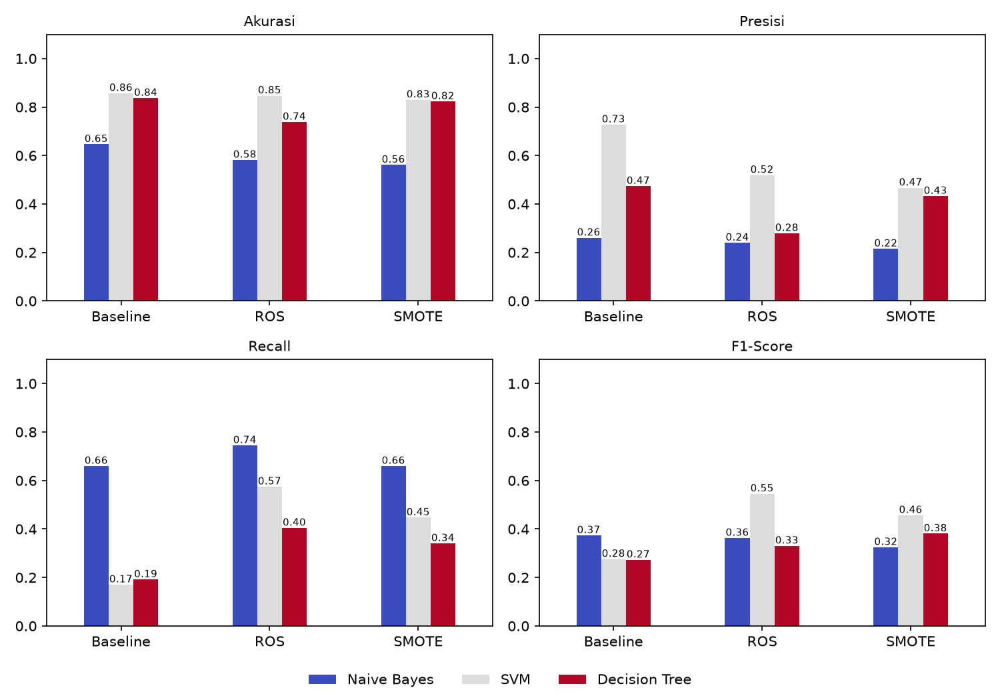

# Klasifikasi Attrition Karyawan: Naïve Bayes, SVM, dan Decision Tree


Proyek ini membandingkan tiga algoritma klasifikasi **Naïve Bayes**, **SVM**, dan **Decision Tree** untuk memprediksi apakah seorang karyawan akan berhenti kerja (*attrition*) atau tidak. Dataset yang digunakan adalah IBM HR Analytics Employee Attrition & Performance, merupakan kelanjutan dari proyek sebelumnya ([ml-hr-attrition-classification](https://github.com/Zelviarani16/ml-hr-attrition-classification)) dengan tambahan dua algoritma baru, tiga skenario resampling, dan aplikasi UI interaktif berbasis Streamlit menggunakan model terbaik.

---

## Dataset

**IBM HR Analytics Employee Attrition & Performance**

- 1.470 baris, 35 kolom
- Target: `Attrition` — `Yes` (berhenti, 16,1%) vs `No` (bertahan, 83,9%)
- Sumber: <https://www.kaggle.com/datasets/pavansubhasht/ibm-hr-analytics-attrition-dataset>

---

## Alur Program

```
Dataset → Preprocessing → Split → Outlier Handling → Transformasi → Resampling → Training → Evaluasi → UI
```

| Tahap | Detail |
|---|---|
| **1. Input** | Membaca dataset, memeriksa distribusi kelas |
| **2. Preprocessing** | Deteksi missing value, duplikasi, outlier (IQR); hapus kolom konstan/ID; encoding target (`Yes` = 1) |
| **3. Split** | 80% training / 20% testing, stratified, `random_state=42` |
| **4. Outlier Handling** | Capping IQR pada 7 kolom — batas dihitung dari data training |
| **5. Transformasi** | Z-Score (numerik) + One-Hot Encoding (kategorikal), di-*fit* hanya pada training |
| **6. Resampling** | Tiga skenario: Baseline, ROS (*Random Over-Sampling*), SMOTE — hanya pada data training |
| **7. Training** | `GaussianNB`, `SVC` (kernel RBF), `DecisionTreeClassifier` (`max_depth=5`) |
| **8. Evaluasi** | Confusion matrix, akurasi, presisi, recall, F1-Score (kelas positif = `Yes`) |
| **9. Pemilihan** | Model dengan akurasi tertinggi (SVM) dipakai pada aplikasi UI |

---

## Hasil Evaluasi (Data Testing: 294 sampel, 47 kelas `Yes`)

| Metode | Skenario | Akurasi | Presisi | Recall | F1-Score |
|---|---|---|---|---|---|
| Naïve Bayes | Baseline | 0,6463 | 0,2605 | 0,6596 | 0,3735 |
| Naïve Bayes | ROS | 0,5816 | 0,2397 | 0,7447 | 0,3627 |
| Naïve Bayes | SMOTE | 0,5612 | 0,2153 | 0,6596 | 0,3246 |
| SVM | Baseline | **0,8571** | **0,7273** | 0,1702 | 0,2759 |
| SVM | ROS | 0,8469 | 0,5192 | 0,5745 | **0,5455** |
| SVM | SMOTE | 0,8299 | 0,4667 | 0,4468 | 0,4565 |
| Decision Tree | Baseline | 0,8367 | 0,4737 | 0,1915 | 0,2727 |
| Decision Tree | ROS | 0,7381 | 0,2794 | 0,4043 | 0,3304 |
| Decision Tree | SMOTE | 0,8231 | 0,4324 | 0,3404 | 0,3810 |



---

## Ringkasan Temuan

- **SVM** memiliki akurasi tertinggi (maks. 0,8571; rata-rata tiga skenario 0,8447), diikuti Decision Tree dan Naïve Bayes.
- **Naïve Bayes** unggul pada recall (maks. 0,7447) tetapi menghasilkan banyak false positive sehingga akurasi dan presisinya rendah.
- Resampling meningkatkan recall secara signifikan pada SVM (0,17 → 0,57 dengan ROS), dengan penurunan akurasi hanya ~0,01.
- **UI memakai SVM + ROS**: akurasi hanya terpaut 0,0102 dari SVM baseline, tetapi recall dan F1-Score jauh lebih baik.

---

## Struktur Folder

```
├── README.md
├── .gitignore
├── Dataset/
│   └── IBM_HR_Attrition.xlsx
├── File Python/
│   ├── klasifikasi.py   # pelatihan, evaluasi, perbandingan, simpan model
│   └── app.py                 # aplikasi UI Streamlit
├── Model/
│   └── model_terbaik.joblib   # model SVM (ROS) + transformer
├── 01_distribusi_attrition.png
├── 02_boxplot_deteksi_outlier.png
├── 03_boxplot_handling_outlier.png
├── 04_confusion_matrix_naive_bayes.png
├── 04_confusion_matrix_svm.png
├── 04_confusion_matrix_decision_tree.png
├── 05_perbandingan_metrik_semua_model.png
├── 06_distribusi_kelas_training.png
└── hasil_perbandingan_semua_model.csv
```

---

## Cara Menjalankan

```bash
# 1. Install dependencies
pip install pandas numpy matplotlib seaborn scikit-learn imbalanced-learn openpyxl joblib streamlit

# 2. Jalankan pelatihan & evaluasi (menghasilkan grafik, CSV, dan folder Model/)
python "File Python/tugas_klasifikasi.py"

# 3. Jalankan aplikasi UI
streamlit run "File Python/app.py"
```

## Hasil (Data Testing: 294 sampel, 47 di antaranya kelas Yes)

| Metode | Skenario | Akurasi | Presisi | Recall | F1-Score |
|---|---|---|---|---|---|
| Naïve Bayes | Baseline | 0,6463 | 0,2605 | 0,6596 | 0,3735 |
| Naïve Bayes | ROS | 0,5816 | 0,2397 | 0,7447 | 0,3627 |
| Naïve Bayes | SMOTE | 0,5612 | 0,2153 | 0,6596 | 0,3246 |
| SVM | Baseline | **0,8571** | **0,7273** | 0,1702 | 0,2759 |
| SVM | ROS | 0,8469 | 0,5192 | 0,5745 | **0,5455** |
| SVM | SMOTE | 0,8299 | 0,4667 | 0,4468 | 0,4565 |
| Decision Tree | Baseline | 0,8367 | 0,4737 | 0,1915 | 0,2727 |
| Decision Tree | ROS | 0,7381 | 0,2794 | 0,4043 | 0,3304 |
| Decision Tree | SMOTE | 0,8231 | 0,4324 | 0,3404 | 0,3810 |


## Ringkasan Temuan

- **SVM** memiliki akurasi tertinggi (maksimum 0,8571; rata-rata tiga skenario 0,8447), diikuti Decision Tree dan Naïve Bayes.
- **Naïve Bayes** unggul pada recall (maksimum 0,7447) tetapi menghasilkan banyak peringatan palsu sehingga akurasi dan presisinya rendah.
- Resampling meningkatkan recall terutama pada SVM (0,17 menjadi 0,57 dengan ROS), dengan akurasi hanya turun sekitar 0,01.
- UI memakai **SVM dengan skenario ROS**: akurasinya hanya terpaut 0,0102 dari SVM tanpa resampling, tetapi recall dan F1-Score jauh lebih baik.

## Catatan

- Evaluasi menggunakan satu kali pembagian data dengan hanya 47 sampel kelas `Yes`, sehingga selisih kecil antarkombinasi perlu dibaca dengan hati-hati.
- Probabilitas pada UI adalah estimasi model yang tidak dikalibrasi karena model dilatih pada data hasil resampling.
- File `Model/model_terbaik.joblib` bergantung pada versi scikit-learn; jalankan ulang `tugas_klasifikasi.py` apabila versi berbeda.